# คู่มือการใช้งานระบบ Learning Management System (LMS) – Hi HR

**เวอร์ชัน**: 5.1  
**วันที่อัปเดตล่าสุด**: 12 ตุลาคม 2026

---

## สารบัญ

**ภาพรวมและการเข้าใช้งาน**

1. [ภาพรวมระบบและ Use Case](#1-ภาพรวมระบบและ-use-case)
2. [การเริ่มต้นใช้งาน](#2-การเริ่มต้นใช้งาน)
3. [หน้าล็อกอิน](#3-หน้าล็อกอิน)
4. [หน้าตั้งค่าแรกเข้า (First Time Setup)](#4-หน้าตั้งค่าแรกเข้า)

**ส่วนผู้เรียน (User)**

5. [หน้าหลักผู้เรียน (Dashboard)](#5-หน้าหลักผู้เรียน-dashboard)
6. [หน้าคอร์สทั้งหมด (All Courses)](#6-หน้าคอร์สทั้งหมด)
7. [หน้ารายละเอียดคอร์ส](#7-หน้ารายละเอียดคอร์ส)
8. [หน้าบทเรียน](#8-หน้าบทเรียน)
9. [หน้าแบบทดสอบและผลคะแนน (Quiz)](#9-หน้าแบบทดสอบและผลคะแนน)

**ส่วนผู้ดูแลระบบ (Admin)**

10. [การจัดการผู้ใช้ (Admin User Management)](#10-การจัดการผู้ใช้)
11. [การจัดการคอร์ส (Admin Course Management)](#11-การจัดการคอร์ส)
12. [หน้ารายละเอียดคอร์ส (Admin)](#12-หน้ารายละเอียดคอร์ส-admin)
13. [หน้า All Quiz Scores (Admin)](#13-หน้า-all-quiz-scores)
14. [หน้า Gemini Settings (Admin)](#14-หน้า-gemini-settings)

**อ้างอิง**

15. [คำถามที่พบบ่อย (FAQ)](#15-คำถามที่พบบ่อย)

---

## 1. ภาพรวมระบบและ Use Case

### 1.1 แผนภาพ Use Case


| Actor | Use Case หลัก |
|-------|---------------|
| **ผู้ดูแลระบบ (Admin)** | ล็อกอิน, เพิ่มผู้ใช้, สร้างคอร์สจาก PDF (AI), ดู/ลบคอร์ส, ดูผู้ใช้และรายละเอียด, ดูความคืบหน้า, ดูผลแบบทดสอบ, ตั้งค่า Gemini AI |
| **ผู้เรียน (User)** | ล็อกอิน, ตั้งค่าแรกเข้า, ดู Dashboard, ลงทะเบียนคอร์ส, เรียนบทเรียน, แชทกับ AI, ทำแบบทดสอบ, ดูผลและคำแนะนำ |

### 1.2 โฟลว์การใช้งานหลัก

```
[ผู้ดูแล] เพิ่มผู้ใช้ (อีเมล) → ผู้ใช้ได้รับรหัสเริ่มต้น haionetime1234
[ผู้ใช้ใหม่] ล็อกอินครั้งแรก → ระบบนำไปหน้าตั้งค่าแรกเข้า
[ผู้ใช้] กรอก Username, ชื่อ-นามสกุล, รหัสผ่านใหม่ → บันทึก → ล็อกอินใหม่
[ผู้ใช้] เข้าสู่ Dashboard → เลือกคอร์ส → ลงทะเบียน → เรียนบทเรียน → ทำแบบทดสอบ
[ผู้ดูแล] Import PDF → AI สร้างคอร์ส 3 ระดับ + แบบทดสอบ → บันทึกลงระบบ
```

---

## 2. การเริ่มต้นใช้งาน

### 2.1 ความต้องการของระบบ

- เบราว์เซอร์: Chrome, Firefox, Safari หรือ Edge (เวอร์ชันล่าสุด)
- การเชื่อมต่ออินเทอร์เน็ต
- บัญชีผู้ใช้จากผู้ดูแลระบบ (ผู้ใช้จะถูกเพิ่มโดย Admin เท่านั้น)

### 2.2 การเข้าถึงระบบ

1. เปิดเว็บเบราว์เซอร์
2. ไปที่ URL ของระบบ
3. หากยังไม่ล็อกอิน จะถูกนำไปยังหน้าล็อกอินโดยอัตโนมัติ


---

## 3. หน้าล็อกอิน

### 3.1 เค้าโครงหน้า

| ตำแหน่ง | ส่วนประกอบ |
|---------|------------|
| **ซ้ายสุด** | Sidebar แสดงข้อมูลทีมพัฒนา (คลิก ☰ เพื่อขยาย/ย่อ) |
| **กลาง-ซ้าย (~65%)** | Logo โปรเจค, ชื่อโปรเจค, คำอธิบาย, โลโก้ NIDA |
| **กลาง-ขวา (~35%)** | การ์ด Sign in พร้อมฟอร์มล็อกอิน |

### 3.2 ปุ่มและองค์ประกอบ

| องค์ประกอบ | การทำงาน |
|-----------|---------|
| **ช่อง Username** | กรอกอีเมลหรือ username ที่ใช้ลงทะเบียน |
| **ช่อง Password** | กรอกรหัสผ่าน |
| **ปุ่ม Sign In** | ส่งข้อมูลล็อกอิน |
| **ไอคอน ☰ (Sidebar)** | ขยาย/ย่อ Sidebar |

### 3.3 พฤติกรรมหลังล็อกอินสำเร็จ

| เงื่อนไข | Redirect ไปที่ |
|---------|---------------|
| ผู้ใช้ใหม่ (is_auth = false) | `/first-time-setup` |
| Admin | `/admin` |
| User ปกติ | `/home` |

### 3.4 รูปภาพ

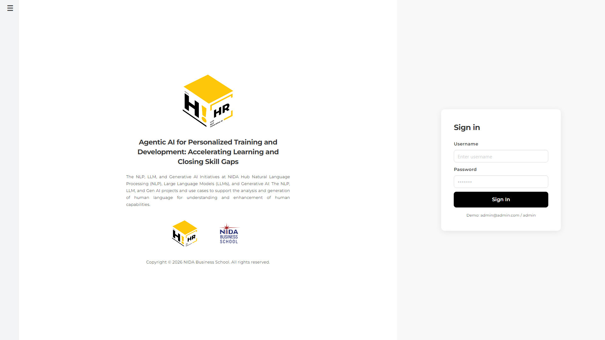

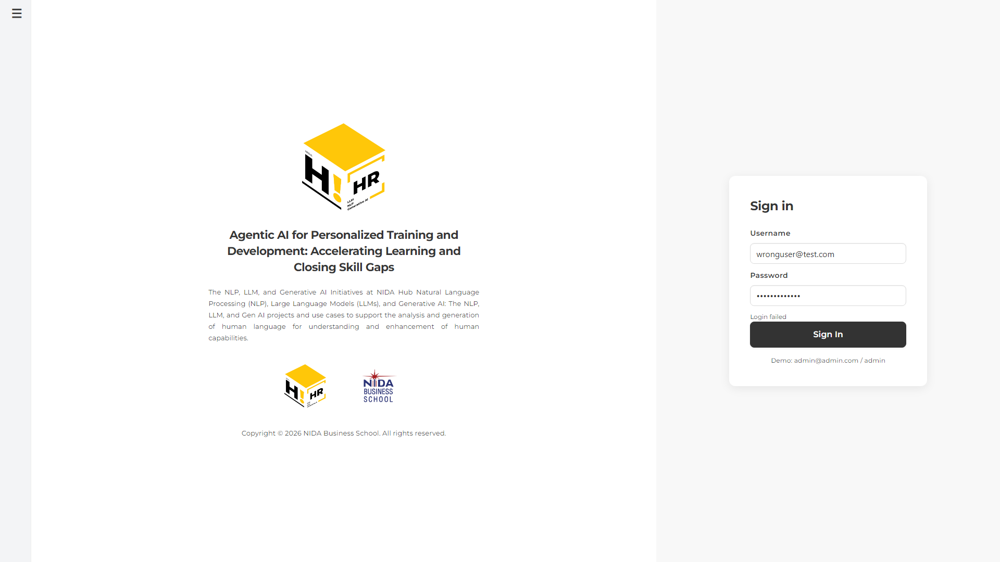

---

## 4. หน้าตั้งค่าแรกเข้า

### 4.1 เค้าโครงหน้า

| ตำแหน่ง | ส่วนประกอบ |
|---------|------------|
| **ซ้ายสุด** | Sidebar (เหมือนหน้าล็อกอิน) |
| **กลาง** | การ์ด 2 ฝั่ง: ซ้าย=Logo + ข้อความ "First Time Setup" + อีเมลปัจจุบัน, ขวา=ฟอร์มตั้งค่า |

### 4.2 ปุ่มและองค์ประกอบ

| องค์ประกอบ | การทำงาน |
|-----------|---------|
| **ช่อง Username** | กรอกชื่อผู้ใช้ที่ต้องการ |
| **ช่อง Full Name** | กรอกชื่อ-นามสกุล |
| **ช่อง New Password** | กรอกรหัสผ่านใหม่ (อย่างน้อย 6 ตัวอักษร) |
| **ช่อง Confirm Password** | กรอกรหัสผ่านซ้ำเพื่อยืนยัน |
| **ปุ่ม Complete Setup** | บันทึก → Logout อัตโนมัติ → redirect ไปหน้าล็อกอิน |

### 4.3 การตรวจสอบข้อมูล

- Username และ Full Name ห้ามว่าง
- รหัสผ่านต้องอย่างน้อย 6 ตัวอักษร
- รหัสผ่านกับ Confirm Password ต้องตรงกัน

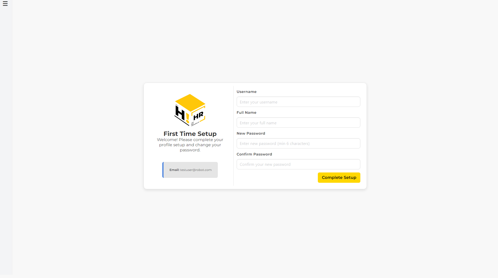

---

# ส่วนผู้เรียน (User)

---

## 5. หน้าหลักผู้เรียน (Dashboard)

### 5.1 เค้าโครงหน้า

| ตำแหน่ง | ส่วนประกอบ |
|---------|------------|
| **ด้านบน** | Header (โลโก้ Hi HR, ช่อง Search, ลิงก์ Dashboard / All Courses, ปุ่ม Logout) |
| **แถวแรก** | 2 คอลัมน์: About Hi HR (ซ้าย) และ Featured Courses สไลด์ (ขวา, พื้นหลังดำ) |
| **แถวที่สอง** | "MY COURSES" พร้อมแท็บ ALL / Resume / Complete |
| **แถวที่สาม** | "MY QUIZ STATUS" แสดงสถานะแบบทดสอบของแต่ละคอร์ส |

### 5.2 ปุ่มและองค์ประกอบ

| องค์ประกอบ | การทำงาน |
|-----------|---------|
| **Dashboard (Header)** | กลับมาหน้านี้ |
| **All Courses (Header)** | ไปหน้าคอร์สทั้งหมด |
| **Logout (Header)** | ออกจากระบบ |
| **แท็บ ALL / Resume / Complete** | กรองคอร์ส: ALL=ทั้งหมด, Resume=กำลังเรียน, Complete=จบแล้ว |
| **ปุ่ม Learn** | ไปหน้ารายละเอียดคอร์สเพื่อเริ่มเรียน |
| **ปุ่ม Resume** | ไปหน้าคอร์สเพื่อเรียนต่อ |
| **ปุ่ม View Course (Featured)** | ไปหน้ารายละเอียดคอร์สที่แสดงในสไลด์ |
| **ลูกศรซ้าย/ขวา** | เปลี่ยนสไลด์ Featured Courses |

### 5.3 หมายเหตุ

- Featured Courses จะเป็น **คอร์สที่แนะนำจาก AI** หากเคยทำแบบทดสอบ หรือแสดงคอร์สทั้งหมดหากยังไม่มีคำแนะนำ
- สไลด์เปลี่ยนอัตโนมัติทุก 7 วินาที
- Progress Bar แสดงจำนวนบทที่เรียนจบ

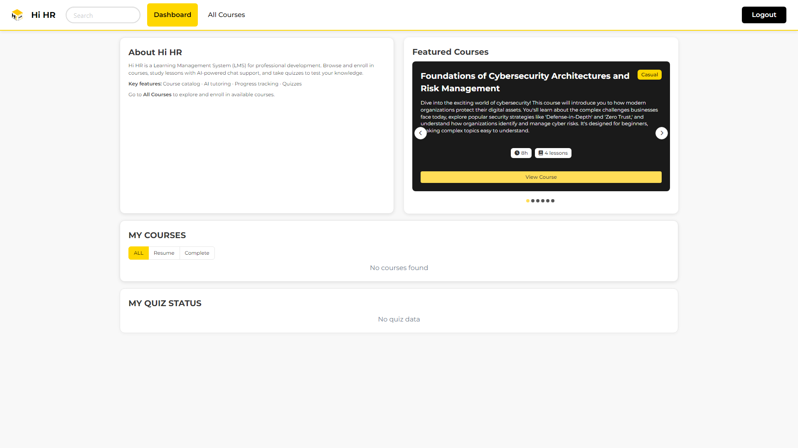

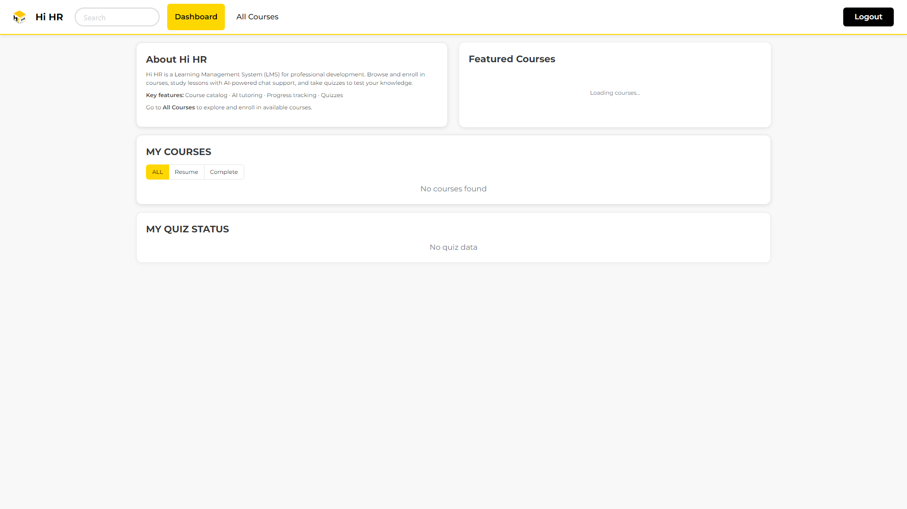


---

## 6. หน้าคอร์สทั้งหมด

### 6.1 เค้าโครงหน้า

| ตำแหน่ง | ส่วนประกอบ |
|---------|------------|
| **ด้านบน** | Header |
| **ใต้ Header** | แผ่นหัว: "All Courses" + Dropdown ระดับความยาก (All Levels / Casual / Regular / Intense) |
| **แถวค้นหา** | ช่อง Search + ตัวนับจำนวนคอร์ส |
| **หลัก** | กริดการ์ดคอร์ส (3 คอลัมน์) + Pagination ด้านล่าง |

### 6.2 ปุ่มและองค์ประกอบ

| องค์ประกอบ | การทำงาน |
|-----------|---------|
| **ช่อง Search** | กรองคอร์สตามชื่อหรือคำอธิบาย (realtime) |
| **Dropdown All Levels** | กรองตามระดับ: Casual, Regular, Intense |
| **ปุ่ม View Detail** | ไปหน้ารายละเอียดคอร์ส (ยังไม่ลงทะเบียน) |
| **ปุ่ม Resume** | ไปหน้าคอร์ส (ลงทะเบียนแล้ว กำลังเรียน) |
| **ปุ่ม Completed** | ไปหน้าคอร์ส (เรียนจบแล้ว) |
| **Pagination** | เปลี่ยนหน้า (แสดง 12 คอร์สต่อหน้า) |

### 6.3 ข้อมูลในการ์ดคอร์ส

- ชื่อคอร์ส
- แท็กสถานะ (Completed / Enrolled) และระดับความยาก
- คำอธิบาย (แสดง 3 บรรทัด)
- จำนวนชั่วโมง และจำนวนบทเรียน


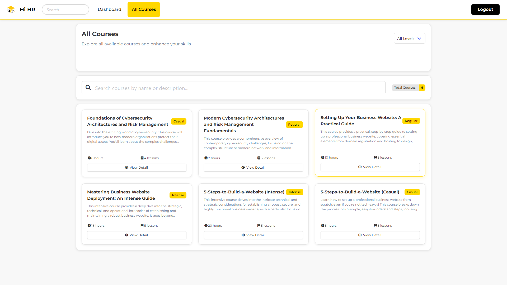

---

## 7. หน้ารายละเอียดคอร์ส

### 7.1 เค้าโครงหน้า

| ตำแหน่ง | ส่วนประกอบ |
|---------|------------|
| **ด้านบน** | Header + Breadcrumb (Home > Courses > ชื่อคอร์ส) |
| **หลัก (ซ้าย)** | แท็กระดับ, ชื่อคอร์ส, คำอธิบาย, Learning Objectives, Prerequisites |
| **หลัก (ขวา)** | กล่อง "Your Progress" (Progress Bar, สถิติ, ปุ่มต่างๆ) |
| **ด้านล่าง** | 2 คอลัมน์: รายการบทเรียน (1/3) + เนื้อหาบทที่เลือก (2/3) |

### 7.2 ปุ่มและองค์ประกอบ

| องค์ประกอบ | การทำงาน |
|-----------|---------|
| **ปุ่ม Start Course** | ลงทะเบียนคอร์ส (ยังไม่ได้ลงทะเบียน) |
| **ปุ่ม Continue Course** | ไปบทเรียนที่ยังไม่จบ (ลงทะเบียนแล้ว) |
| **ปุ่ม Course Completed** | แสดงสถานะจบแล้ว (disabled) |
| **ปุ่ม Take Assessment** | ไปหน้าแบบทดสอบ |
| **ปุ่ม Quiz Result** | ดูผลแบบทดสอบ (ทำแล้ว) |
| **รายการบทเรียน** | คลิกเพื่อดู Preview ด้านขวา |
| **ปุ่ม Start/Continue/Review Lesson** | ไปหน้าบทเรียน |

### 7.3 สถานะบทเรียน

| ไอคอน | สถานะ |
|--------|--------|
| ○ (วงกลมเทา) | ยังไม่เริ่ม |
| ▶ (สีฟ้า) | กำลังเรียน |
| ✓ (สีเขียว) | เรียนจบแล้ว |


---

## 8. หน้าบทเรียน

### 8.1 เค้าโครงหน้า

| ตำแหน่ง | ส่วนประกอบ |
|---------|------------|
| **ด้านบน** | Header + Breadcrumb (Home > Courses > ชื่อคอร์ส > ชื่อบท) |
| **หลัก (ซ้าย 9/12)** | ชื่อบท, แท็กเวลา/ลำดับ/สถานะ, เนื้อหา, ปุ่ม Actions |
| **หลัก (ขวา 3/12)** | Sidebar: Course Progress + รายการบทเรียนนำทาง |
| **ด้านล่าง** | แถบนำทาง: Previous | Lesson x of y | Next |
| **มุมขวาล่าง** | ปุ่มลอย "Chat with AI" |

### 8.2 ปุ่มและองค์ประกอบ

| องค์ประกอบ | การทำงาน |
|-----------|---------|
| **ปุ่ม Mark as Complete** | บันทึกว่าบทเรียนจบ → อัปเดต progress |
| **ปุ่ม Chat with AI** | เปิด Modal แชทกับ AI |
| **ปุ่มลอย Chat (มุมขวาล่าง)** | เปิด Modal แชทกับ AI |
| **ปุ่ม Previous / Next** | ไปบทก่อนหน้า / ถัดไป |
| **รายการบทใน Sidebar** | คลิกเพื่อไปบทนั้นโดยตรง |
| **ปุ่ม Bookmark** | บุ๊คมาร์ค (placeholder) |
| **ปุ่ม Share** | แชร์ (placeholder) |

### 8.3 Modal แชท AI

| องค์ประกอบ | การทำงาน |
|-----------|---------|
| **ช่องข้อความ** | พิมพ์คำถาม กด Enter หรือคลิกส่ง |
| **ปุ่มถังขยะ** | ล้างประวัติแชท |
| **ปุ่ม X** | ปิด Modal |
| **AI ตอบ** | ตอบจากเนื้อหาบทเรียน (RAG) |

### 8.4 ประเภทเนื้อหา

- **Text**: แสดง HTML / Markdown พร้อม syntax highlighting
- **Video**: YouTube (iframe) หรือ video file
- **Image**: รูปภาพประกอบ


---

## 9. หน้าแบบทดสอบและผลคะแนน

### 9.1 ขณะทำแบบทดสอบ

| ตำแหน่ง | ส่วนประกอบ |
|---------|------------|
| **ด้านบน** | Header |
| **หลัก** | ชื่อ Quiz, คำอธิบาย, Progress Bar (Question x of y), การ์ดคำถาม |
| **ด้านล่าง** | ปุ่ม Previous Question / Next Question / Submit Quiz |

### 9.2 ประเภทคำถาม

| ประเภท | วิธีตอบ |
|--------|--------|
| **Multiple Choice** | เลือก radio button |
| **Subjective** | พิมพ์คำตอบยาวใน textarea |
| **Fill in the Blank** | พิมพ์คำตอบสั้นใน text input |

### 9.3 หลังส่งแบบทดสอบ (Quiz Completed)

| ตำแหน่ง | ส่วนประกอบ |
|---------|------------|
| **บน** | "Quiz Completed!" + วงกลมคะแนน (%) + ข้อความผ่าน/ไม่ผ่าน |
| **กลาง** | AI Analysis: Strength, Weakness |
| **ล่าง** | Recommendations: Intensive Lessons (คอร์สระดับอื่นในหัวข้อเดียวกัน), Related Lessons |
| **ปุ่ม** | Back to Course |

### 9.4 เกณฑ์ผ่าน

- คะแนน ≥ 70% = **ผ่าน** (Congratulations!)
- คะแนน < 70% = **ไม่ผ่าน** (แนะนำให้ทบทวน)

### 9.5 หมายเหตุ

- แบบทดสอบทำได้ **ครั้งเดียว** ต่อคอร์ส
- คำถาม Subjective/Fill in the Blank จะถูก **AI ตรวจ** ให้คะแนนอัตโนมัติ
- หลังทำเสร็จ สามารถดูผลได้ที่ปุ่ม "Quiz Result" ในหน้ารายละเอียดคอร์ส

### 9.6 หน้าผลแบบทดสอบ (Quiz Result)

ผู้เรียนสามารถดูผลแบบทดสอบได้ตลอดเวลาหลังจากทำเสร็จ โดยกดปุ่ม "Quiz Result" ในหน้ารายละเอียดคอร์ส

| ตำแหน่ง | ส่วนประกอบ |
|---------|------------|
| **ด้านบน** | Header |
| **หลัก (บน)** | ชื่อคอร์ส, วงกลมคะแนน (%), ข้อความผ่าน/ไม่ผ่าน |
| **หลัก (กลาง)** | AI Analysis: จุดแข็ง (Strengths) และจุดที่ควรปรับปรุง (Weaknesses) |
| **หลัก (ล่าง)** | Recommendations: Intensive Lessons (คอร์สระดับอื่นในหัวข้อเดียวกัน), Related Lessons |
| **ปุ่ม** | Back to Course, ลิงก์ไปบทเรียนที่แนะนำ |

#### การเข้าถึงผลแบบทดสอบ

- **จากหน้ารายละเอียดคอร์ส**: กดปุ่ม "Quiz Result" (แสดงเมื่อทำ quiz แล้ว)
- **จากหน้า Quiz Completed**: ระบบแสดงผลทันทีหลังส่ง quiz

#### คำแนะนำจาก AI

- **Intensive Lessons**: บทเรียนระดับอื่น (เช่น Regular/Intense) ในหัวข้อเดียวกันที่ควรเรียนเพิ่ม
- **Related Lessons**: บทเรียนที่เกี่ยวข้องในคอร์สอื่นที่ช่วยเสริมจุดอ่อน
- ผู้เรียนสามารถคลิกที่คำแนะนำเพื่อไปเรียนบทนั้นได้เลย (ถ้ายังไม่ enroll จะมี modal ให้ลงทะเบียนก่อน)


---

# ส่วนผู้ดูแลระบบ (Admin)

---

## 10. การจัดการผู้ใช้

### 10.1 แดชบอร์ดผู้ดูแลระบบ (All Users)

#### เค้าโครงหน้า

| ตำแหน่ง | ส่วนประกอบ |
|---------|------------|
| **ด้านบน** | Header (ลิงก์ All Users / All Courses / Setting, ปุ่ม Logout) |
| **หลัก** | แผ่น "All Users": ปุ่ม Add User, ช่อง Search, ตารางผู้ใช้ |

#### ตารางผู้ใช้

| คอลัมน์ | คำอธิบาย |
|---------|----------|
| Username | ชื่อผู้ใช้ |
| Email | อีเมล |
| Role | แท็ก admin (แดง) หรือ user (ฟ้า) |
| Status | Active |
| Auth Status | Authenticated / First Login Required |
| Actions | ปุ่ม View Details, ปุ่ม Delete |

#### ปุ่มและองค์ประกอบ

| องค์ประกอบ | การทำงาน |
|-----------|---------|
| **ปุ่ม Add User** | เปิด Modal เพิ่มผู้ใช้ |
| **ช่อง Search** | กรองตาม username หรือ email |
| **ปุ่ม View Details** | ไปหน้ารายละเอียดผู้ใช้ |
| **ปุ่ม Delete** | ลบผู้ใช้ (ไม่สามารถลบ admin ได้) |

#### Modal เพิ่มผู้ใช้

| องค์ประกอบ | การทำงาน |
|-----------|---------|
| **ช่อง Email** | กรอกอีเมลผู้ใช้ใหม่ |
| **ปุ่ม Add User** | สร้างผู้ใช้ → รหัสเริ่มต้น `haionetime1234` |
| **ปุ่ม Cancel / X** | ปิด Modal |

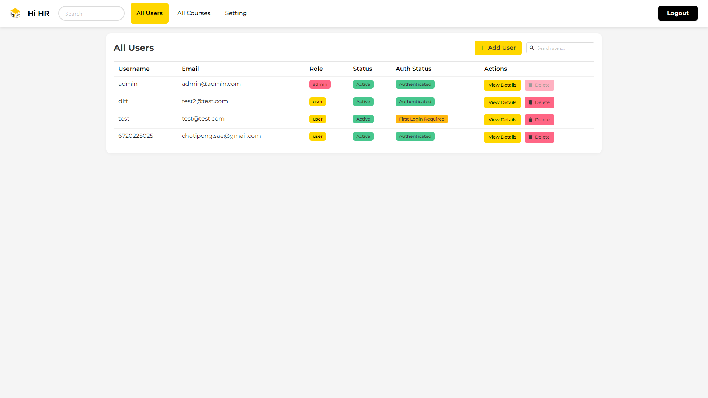

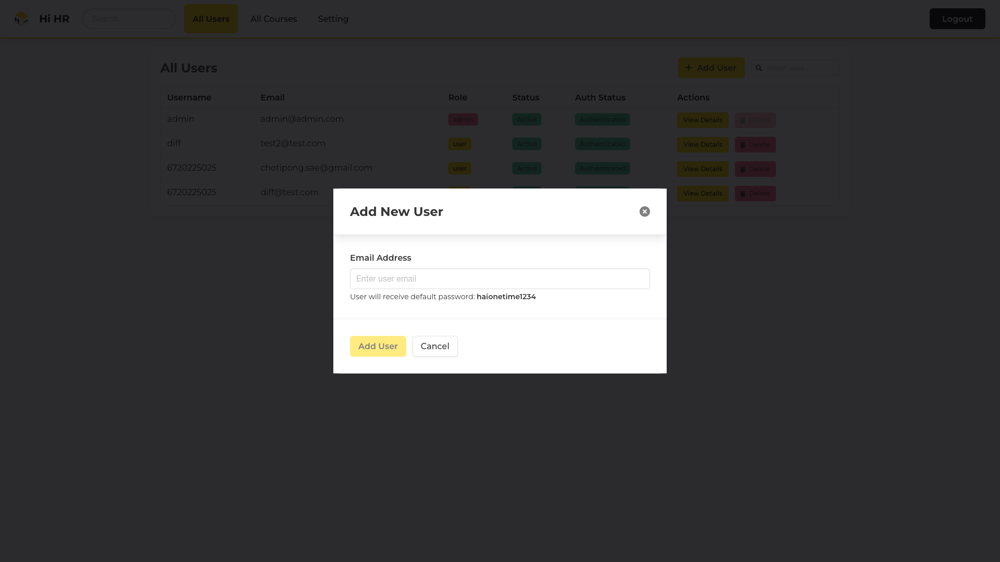

### 10.2 หน้ารายละเอียดผู้ใช้

#### เค้าโครงหน้า

| ตำแหน่ง | ส่วนประกอบ |
|---------|------------|
| **ด้านบน** | Header + ปุ่ม "Back to Users" |
| **หัวผู้ใช้** | ชื่อ, แท็ก Role/Email, สถิติ (Username, Enrolled Courses, Quizzes Taken), User Info |
| **แท็บ** | Enrolled Courses / Quiz Results |
| **มุมขวาล่าง** | ปุ่ม Delete User (ลอย, สีแดง) |

#### แท็บ Enrolled Courses

- การ์ดคอร์ส (2 คอลัมน์) แสดง Progress Bar, ระดับ, สถานะ
- ปุ่ม "View Course" → ไปหน้า Admin Course Detail

#### แท็บ Quiz Results

| คอลัมน์ | คำอธิบาย |
|---------|----------|
| Course | ชื่อคอร์ส |
| Score | คะแนน x/y |
| Status | Completed |
| Date Taken | วันที่ทำ |
| Actions | View Course, View Answers |

#### Modal View Answers

- แสดง Course name, Score, Percentage
- รายการคำถามทีละข้อ:
  - ข้อความคำถาม
  - คำตอบผู้ใช้ (พร้อมแท็ก Correct สีเขียว / Incorrect สีแดง)
  - เฉลย (คำตอบที่ถูกต้อง)

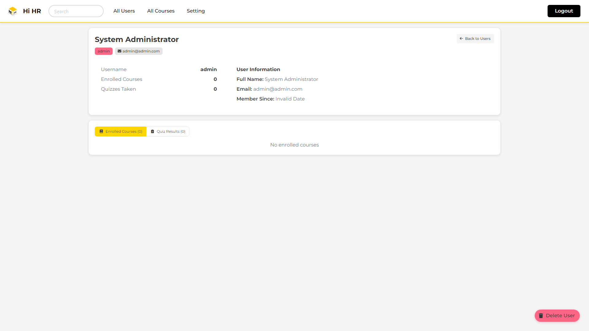


### 10.3 การลบผู้ใช้

- คลิกปุ่ม "Delete" ในตาราง All Users หรือปุ่ม "Delete User" ในหน้ารายละเอียดผู้ใช้
- ระบบแสดง Modal ยืนยัน → แสดงข้อมูลที่จะถูกลบ:
  - บัญชีผู้ใช้และข้อมูลทั้งหมด
  - การลงทะเบียนคอร์สและความคืบหน้า
  - ผลแบบทดสอบทั้งหมด
- คลิก "Delete User" เพื่อยืนยัน หรือ "Cancel" เพื่อยกเลิก
- **หมายเหตุ**: ไม่สามารถลบ Admin ได้ (ปุ่ม Delete จะ disabled)

---

## 11. หน้าจัดการคอร์ส

### 11.1 เค้าโครงหน้า

| ตำแหน่ง | ส่วนประกอบ |
|---------|------------|
| **ด้านบน** | Header + ปุ่ม "Import Document" |
| **แท็บหลัก** | Courses (รายการคอร์ส) / Process (Background Tasks) |

### 11.2 แท็บ Courses

- ช่อง Search กรองคอร์ส
- กริดการ์ดคอร์ส (ชื่อ, ระดับ, คำอธิบาย, ชั่วโมง, บทเรียน, จำนวนผู้ลงทะเบียน)
- ปุ่ม "View Details" → ไปหน้า Admin Course Detail

### 11.3 แท็บ Process

- สถิติ: Queued / Generating / Completed / Generated / Failed
- ตาราง Background Tasks (Document, Difficulty, Status, Created, Actions)
- ปุ่ม Preview (task สำเร็จ), Retry (task error), Delete

### 11.4 Modal Import Document

| องค์ประกอบ | การทำงาน |
|-----------|---------|
| **เลือกไฟล์ PDF** | อัปโหลดเอกสารต้นฉบับ |
| **Quiz Configuration** | ตั้งค่าจำนวนคำถามแต่ละประเภท |
| **ปุ่ม Generate All Levels** | สร้าง 3 tasks (Casual/Regular/Intense) → สลับไปแท็บ Process |

### 11.5 ขั้นตอนการสร้างคอร์ส

```
1. คลิก "Import Document" → เลือก PDF → ตั้งค่า Quiz → Generate All Levels
2. ระบบสร้าง 3 Background Tasks (Casual, Regular, Intense)
3. รอจนสถานะ = Completed → คลิก Preview
4. ตรวจสอบ/แก้ไขคอร์ส → คลิก "Create Quiz"
5. ตรวจสอบ/แก้ไข Quiz → คลิก "Submit Quiz" → บันทึกลง Database
```

### 11.6 หน้า Course Preview

| ตำแหน่ง | ส่วนประกอบ |
|---------|------------|
| **ด้านบน** | Header + หัวข้อ "Course Preview" + ปุ่ม "Back to Courses" |
| **แท็บ** | Course Preview / Agent Logs / Agent Diagram |
| **หลัก (Course Preview)** | ข้อมูลคอร์ส (ชื่อ, คำอธิบาย, ระดับ, ชั่วโมง), Learning Objectives, Prerequisites, รายการบทเรียน (Expandable) |
| **ด้านล่าง** | ปุ่ม "Re-Generate" + ปุ่ม "Create Quiz" |

#### ปุ่มและองค์ประกอบ

| องค์ประกอบ | การทำงาน |
|-----------|---------|
| **ช่อง Course Name** | แก้ไขชื่อคอร์สได้ |
| **บทเรียน (Expandable)** | คลิกขยายดูเนื้อหา Markdown ของแต่ละบท |
| **ปุ่ม Edit (ในบทเรียน)** | เปิดช่อง prompt สำหรับสั่ง AI แก้ไขบทเรียนนั้น |
| **ปุ่ม Save Changes** | บันทึกการแก้ไขจาก AI (หลัง preview) |
| **ปุ่ม Discard Changes** | ยกเลิกการแก้ไข กลับไปเนื้อหาเดิม |
| **ปุ่ม Re-Generate** | สร้างคอร์สใหม่ทั้งหมดจากเอกสารเดิม |
| **ปุ่ม Create Quiz** | ส่งเนื้อหาคอร์สไปให้ AI สร้างแบบทดสอบ → ไปหน้า Quiz Preview |

#### แท็บ Agent Logs

- แสดง Token Usage Summary ด้านบน (Prompt tokens, Completion tokens, Total tokens)
- แสดง log แบบแยกกลุ่มตาม Pipeline Stage (Planning / Lesson Writing / Assembly)
- แต่ละ log entry แสดงชื่อ Agent, ประเภท output, จำนวน characters และ token usage ของ step นั้น
- รองรับ Agent ใหม่: planner_agent, outline_reviewer, lesson_writer_L1-LN, lesson_reviewer_L1-LN, assembler

#### แท็บ Agent Diagram

- แสดงภาพ **Agent Pipeline Flow** แบบ interactive graph (ใช้ React Flow)
- **Drag & Drop**: ลาก node ได้อิสระ, Pan (ลาก canvas), Zoom (scroll wheel)
- **MiniMap**: แผนที่ย่อมุมล่างซ้ายสำหรับ navigate
- **Controls**: ปุ่ม Zoom In/Out/Fit มุมล่างขวา
- **กล่อง Group**: Writer + Reviewer ของแต่ละ Lesson ถูกครอบด้วยกล่องสีม่วง (Lesson 1, Lesson 2, ...)
- **เส้นเชื่อม**: เส้นทึบ + ลูกศร animated = Data flow, เส้นประสีม่วง = Review loop
- **Token Usage**: แต่ละ node แสดงจำนวน token ที่ใช้ + Total Token Usage Summary ด้านล่าง
- **คลิก node**: แสดงรายละเอียด log entries ของ agent นั้นพร้อม token breakdown (in/out)

#### การแก้ไขบทเรียน

1. คลิกปุ่ม "Edit" ที่บทเรียนที่ต้องการแก้ไข
2. พิมพ์ prompt บอก AI ว่าต้องการเปลี่ยนอะไร (เช่น "แก้ไขให้ละเอียดกว่านี้ เพิ่มตัวอย่าง 1-2 ตัวอย่าง สถานการณ์จริง")
3. คลิก "Regenerate" → AI สร้างเนื้อหาใหม่
4. ระบบแสดงป้าย "Preview" สีเหลือง บนบทเรียนที่แก้ไข
5. ตรวจสอบ → คลิก "Save Changes" เพื่อยืนยัน หรือ "Discard Changes" เพื่อยกเลิก


### 11.7 หน้า Quiz Preview

| ตำแหน่ง | ส่วนประกอบ |
|---------|------------|
| **ด้านบน** | Header + หัวข้อ "Quiz Preview" + ปุ่ม "Back to Course Preview" |
| **แท็บ** | Quiz Preview / Agent Logs / Agent Diagram |
| **หลัก (Quiz Preview)** | ข้อมูล Quiz (ชื่อ, คำอธิบาย, จำนวนคำถาม), รายการคำถาม (Expandable) พร้อมตัวเลือก/คำตอบ |
| **ด้านล่าง** | ปุ่ม "Re-Generate" + ปุ่ม "Submit Quiz" |

#### ปุ่มและองค์ประกอบ

| องค์ประกอบ | การทำงาน |
|-----------|---------|
| **คำถาม (Expandable)** | คลิกขยายดูตัวเลือกและคำตอบที่ถูกต้อง |
| **ปุ่ม Edit (ในคำถาม)** | เปิดช่อง prompt สำหรับสั่ง AI แก้ไขคำถามนั้น |
| **ปุ่ม Save Changes** | บันทึกการแก้ไขคำถามจาก AI |
| **ปุ่ม Discard Changes** | ยกเลิกการแก้ไข กลับไปคำถามเดิม |
| **ปุ่ม Re-Generate** | สร้าง Quiz ใหม่ทั้งหมด |
| **ปุ่ม Submit Quiz** | บันทึกคอร์ส + Quiz ลง Database → กลับหน้า Course Management |

#### แท็บ Agent Logs

- แสดง Token Usage Summary ด้านบน (Prompt tokens, Completion tokens, Total tokens)
- แสดง log แบบแยกกลุ่มตาม Pipeline Stage (Planning / Question Writing / Assembly)
- แต่ละ log entry แสดงชื่อ Agent, ประเภท output, จำนวน characters และ token usage
- รองรับ Agent ใหม่: quiz_planner, quiz_planner_reviewer, question_writer_T0-TN, question_reviewer_T0-TN, assembler

#### แท็บ Agent Diagram

- แสดงภาพ **Agent Pipeline Flow** แบบ interactive graph
- มีกล่อง Group ครอบ Writer + Reviewer ของแต่ละ Topic (Topic 1, Topic 2, ...)
- Feature เดียวกับ Course Preview: Drag, Zoom, MiniMap, เส้นเชื่อม, Token Usage per node + Total

#### การแก้ไขคำถาม

1. คลิกปุ่ม "Edit" ที่คำถามที่ต้องการแก้ไข
2. พิมพ์ prompt (เช่น "เปลี่ยนคำถามให้ยากกว่านี้")
3. คลิก "Regenerate" → AI สร้างคำถามใหม่
4. ตรวจสอบ → "Save Changes" หรือ "Discard Changes"


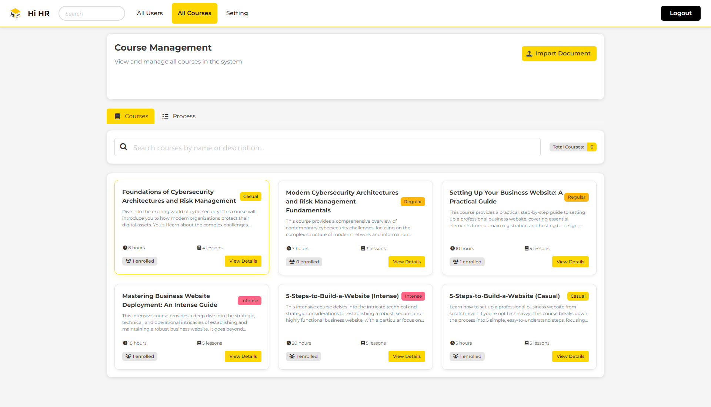

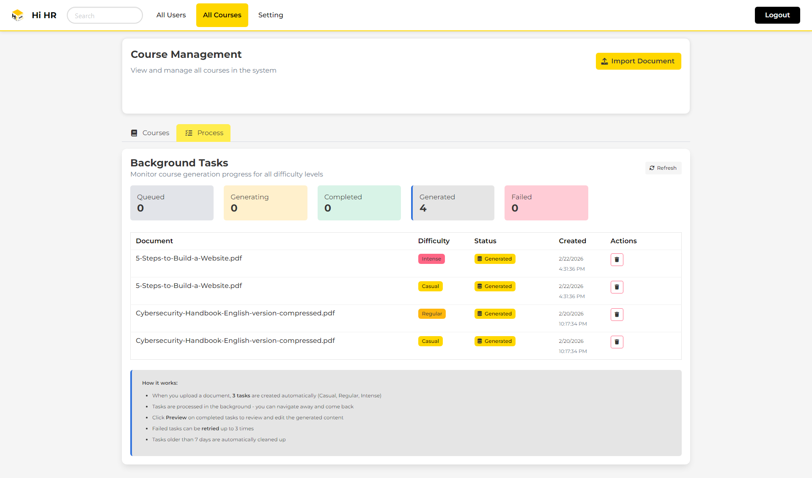

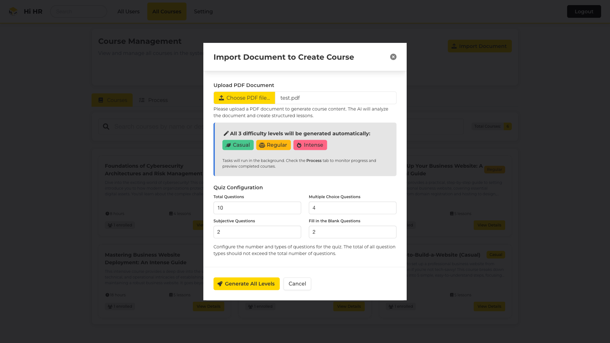

---

## 12. หน้ารายละเอียดคอร์ส (Admin)

### 12.1 เค้าโครงหน้า

| ตำแหน่ง | ส่วนประกอบ |
|---------|------------|
| **ด้านบน** | Header + ลิงก์ "Back to Courses" |
| **หัวคอร์ส** | ชื่อ, แท็กระดับ, สถิติ (Total Hours, Total Lessons, Enrolled Students), คำอธิบาย |
| **แท็บ** | Course / Quiz / Enrolled Users |
| **มุมขวาล่าง** | ปุ่ม Delete Course (ลอย, สีแดง) |

### 12.2 แท็บ Course

- Learning Objectives
- Prerequisites
- รายการบทเรียน (ขยายดูเนื้อหาได้)

### 12.3 แท็บ Quiz

- ข้อมูล Quiz (ชื่อ, คำอธิบาย, จำนวนคำถาม)
- รายการคำถามพร้อมตัวเลือกและคำตอบที่ถูกต้อง

### 12.4 แท็บ Enrolled Users

| คอลัมน์ | คำอธิบาย |
|---------|----------|
| Username | ชื่อผู้ใช้ |
| Email | อีเมล |
| Progress | Progress Bar |
| Quiz Status | สถานะแบบทดสอบ |
| Quiz Score | คะแนน |
| Actions | ปุ่ม View User |

### 12.5 การลบคอร์ส

- คลิกปุ่ม "Delete Course" → Modal ยืนยัน → ลบคอร์ส, บทเรียน, Quiz, การลงทะเบียน และ Progress ทั้งหมด

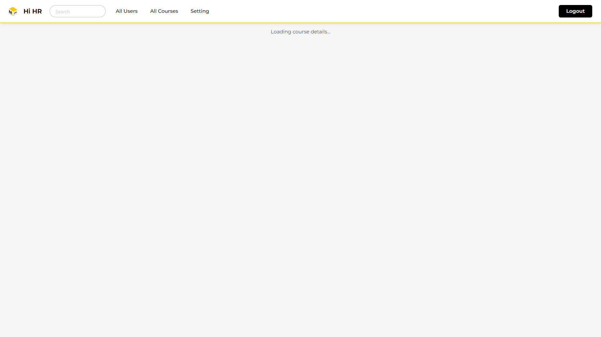


---

## 13. หน้า All Quiz Scores

### 13.1 เค้าโครงหน้า

| ตำแหน่ง | ส่วนประกอบ |
|---------|------------|
| **ด้านบน** | Header |
| **หลัก** | "All Quiz Scores" + ช่อง Search + ตารางคะแนน + Pagination |

### 13.2 ตารางคะแนน

| คอลัมน์ | คำอธิบาย |
|---------|----------|
| Username | ชื่อผู้ใช้ |
| Course | ชื่อคอร์ส |
| Score | คะแนน (เช่น 15/20) |
| Status | Completed |
| Date | วันที่ทำ |
| Actions | ปุ่ม View Course |

### 13.3 ปุ่มและองค์ประกอบ

| องค์ประกอบ | การทำงาน |
|-----------|---------|
| **ช่อง Search** | กรองตาม username หรือชื่อคอร์ส |
| **ปุ่ม View Course** | ไปหน้า Admin Course Detail |
| **Pagination** | เปลี่ยนหน้า (Previous / Next / เลขหน้า) |

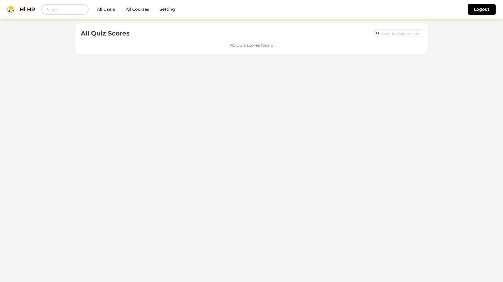

---

## 14. หน้า Gemini Settings

### 14.1 เค้าโครงหน้า

| ตำแหน่ง | ส่วนประกอบ |
|---------|------------|
| **ด้านบน** | Header |
| **หลัก** | "Gemini API Settings" |
| **Section 1** | API Key: แสดง key (masked), source (Web Config / .env), ปุ่ม Change Key / Revert to .env |
| **Section 2** | Model Configuration by Role: 3 การ์ด (Planner, Writer, Grader) แต่ละตัวมี model + status + ปุ่ม Edit |
| **Section 3** | Available Models: ตารางรุ่น Gemini ที่ใช้ได้ พร้อมแสดงว่าแต่ละ model ถูกใช้โดย role ไหน |

### 14.2 การตั้งค่า Model แยกตาม Role

ระบบรองรับการกำหนด AI model แยกตาม 3 บทบาท:

| Role | หน้าที่ | Model แนะนำ |
|------|---------|-------------|
| **Planner / Reviewer** | วางโครงร่างคอร์ส/Quiz, ตรวจสอบ outline | Flash (เร็ว, ถูก) |
| **Content Writer** | เขียนเนื้อหาบทเรียน, สร้างคำถาม Quiz | Pro (สร้างสรรค์, ละเอียด) |
| **Grader / Evaluator** | ตรวจคำตอบแบบทดสอบ, ให้คะแนน | Flash (เร็ว, ถูก) |

### 14.3 ปุ่มและองค์ประกอบ

| องค์ประกอบ | การทำงาน |
|-----------|---------|
| **ปุ่ม Set Key** | เปิด Modal กำหนด API Key ใหม่ |
| **ปุ่ม Revert to .env** | ลบ custom key กลับไปใช้ key จาก .env file |
| **ปุ่ม Edit (แต่ละ Role)** | เปิด Modal เลือก model สำหรับ role นั้น |
| **ปุ่ม Set All** | เปิด Modal ตั้ง model เดียวกันให้ทุก role พร้อมกัน |
| **Status Badge (Active/Inactive)** | แสดงสถานะของแต่ละ role ว่า model ใช้งานได้หรือไม่ |

### 14.4 หมายเหตุ

- การเปลี่ยน model จะมีผลกับการสร้างคอร์ส/Quiz ครั้งถัดไป
- ระบบจะ validate model ก่อนบันทึก (ทดสอบเรียก API จริง)
- หากไม่เคยตั้งค่า role แยก ระบบจะใช้ model เดียวกันทุก role (backward compatible)
- API Key ใช้ร่วมกันทุก role (key เดียว)
- Status "Active" หมายถึง model นั้นตอบกลับได้ปกติ
- ถ้ายังไม่เคยตั้งค่า model ทุก role ใช้ `gemini-3.5-flash` เป็นค่าตั้งต้น
- Gemini API คิดเงินแบบเติมเครดิตล่วงหน้า (Prepay) ถ้าเครดิตหมด ระบบจะสร้างคอร์ส Quiz และ Chat ไม่ได้ และการบันทึก model จะแจ้งว่าเครดิตหมด (402) ให้ผู้ดูแล Google Cloud project เติมเครดิตที่ aistudio.google.com/billing

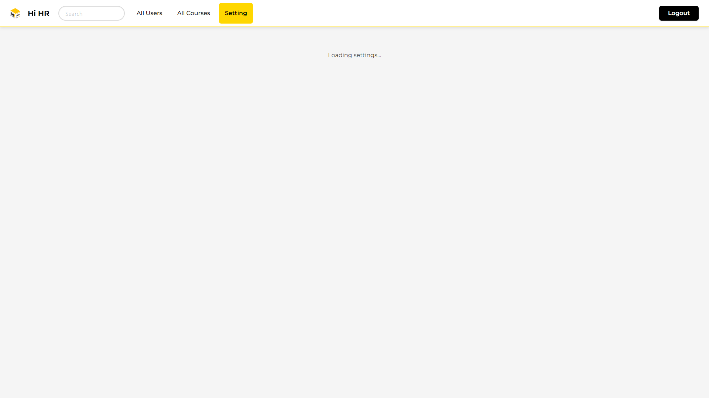

---

# อ้างอิง

---

## 15. คำถามที่พบบ่อย

### ทั่วไป

**Q: สามารถสมัครสมาชิกเองได้หรือไม่?**  
A: ไม่ได้ ผู้ใช้จะถูกเพิ่มโดย Admin เท่านั้น

**Q: รหัสผ่านเริ่มต้นคืออะไร?**  
A: `haionetime1234` (สำหรับผู้ใช้ที่ Admin เพิ่มเข้ามา)

**Q: บัญชี Demo สำหรับทดสอบ?**  
A: admin@admin.com / admin

**Q: ลืมรหัสผ่าน ทำอย่างไร?**  
A: ติดต่อผู้ดูแลระบบเพื่อรีเซ็ตบัญชี

### การเรียน

**Q: ต้องเรียนบทเรียนตามลำดับหรือไม่?**  
A: แนะนำให้เรียนตามลำดับ แต่สามารถเลือกบทใดก็ได้จาก Sidebar

**Q: แบบทดสอบทำซ้ำได้หรือไม่?**  
A: ไม่ได้ สามารถทำได้ครั้งเดียวต่อคอร์ส

**Q: AI Chatbot ตอบคำถามจากไหน?**  
A: จากเนื้อหาบทเรียนที่กำลังเรียนอยู่ (ใช้เทคนิค RAG)

**Q: Featured Courses เลือกมาจากอะไร?**  
A: หากเคยทำ Quiz แล้ว AI จะแนะนำคอร์สที่เหมาะสม หากยังไม่มีผล Quiz จะแสดงคอร์สทั้งหมด

### ผู้ดูแลระบบ

**Q: สร้างคอร์สได้อย่างไร?**  
A: All Courses → Import Document → เลือก PDF → ตั้งค่า Quiz → Generate All Levels → รอ Processing → Preview → Submit

**Q: ลบคอร์สจะเกิดอะไรขึ้น?**  
A: ลบทุกอย่างที่เกี่ยวข้อง (บทเรียน, แบบทดสอบ, การลงทะเบียน, ความคืบหน้า)

**Q: เปลี่ยนรุ่น Gemini มีผลอย่างไร?**  
A: มีผลกับการสร้างคอร์ส/Quiz/Chat ครั้งถัดไป คอร์สที่สร้างไปแล้วไม่เปลี่ยน สามารถตั้งค่า model แยกตาม role ได้ (Planner, Writer, Grader)

**Q: สร้างคอร์สไม่ได้ และมีข้อความว่าเครดิตหมดหรือ 402?**  
A: เครดิต Gemini API (Prepay) ของ project หมด ให้ผู้ดูแล Google Cloud project เติมเครดิตที่ aistudio.google.com/billing หลังเติมเครดิตแล้วใช้งานต่อได้ตามปกติ

**Q: Token Usage คืออะไร?**  
A: จำนวน token ที่ AI ใช้ในการประมวลผล แบ่งเป็น Prompt (input) และ Completion (output) ยิ่งใช้เยอะ ค่าใช้จ่าย API ยิ่งสูง ดูได้ในแท็บ Agent Logs และ Agent Diagram

**Q: Import PDF รองรับกี่หน้า?**  
A: ไม่จำกัดจำนวนหน้า แต่เอกสารขนาดใหญ่จะใช้เวลาสร้างนานขึ้น ระบบจะ compress อัตโนมัติ

---

## การติดต่อ

หากพบปัญหาในการใช้งานระบบ กรุณาติดต่อผู้ดูแลระบบ

---

*Copyright © 2026 NIDA Business School. All rights reserved.*
